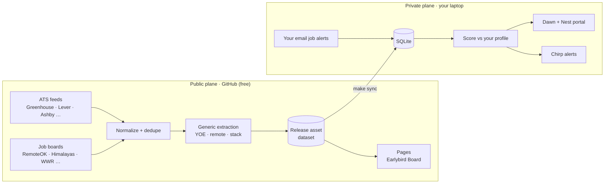

# Earlybird

**The early bird gets the job.**

*Every new role from company career pages, filtered to you, the morning it opens.*

> **Status:** Phase 0 (Foundation). Nothing runs yet. This README describes what is being built. Real coverage numbers will replace the placeholders once we have them. See the [roadmap](docs/roadmap.md).

Earlybird watches public company career feeds (Greenhouse, Lever, Ashby and more) and open job boards. It deduplicates what it finds, pulls out the facts that matter (experience range, remote eligibility, stack) and ranks every new posting against **your** profile, so a 15-minute morning triage covers everything that opened since yesterday.

## What it does

| | Feature | What it does |
| --- | --- | --- |
| 🌅 | **Dawn** | The morning view: everything new since your last visit, deduped and ranked, strong matches first |
| 🪺 | **Nest** | Your tracker: new → seen → saved → applied → interviewing → offer, with notes |
| 🌿 | **Perch** | Watchlist companies: their jobs always reach you and are never filtered out |
| 🐦 | **Chirp** | Telegram alerts for strong matches at watchlist companies |
| 🐦‍⬛ | **Flock** | Discovery: finds new companies and adds them to the registry automatically |
| 📋 | **Earlybird Board** | A public, static board of the collected jobs |

## How it works



- The **public plane** only ever handles public data: job cards, generic facts, and links back to the original posting.
- The **private plane** holds everything personal: your profile, scores, statuses, notes, and jobs from your email alerts. None of it is ever published.

More detail is in [docs/architecture.md](docs/architecture.md).

## Quickstart

> Requires macOS or Linux, [uv](https://docs.astral.sh/uv/) and `make`. No Docker.

```bash
git clone https://github.com/mohangowdatdev/earlybird.git && cd earlybird
make setup                          # uv sync + pre-commit hooks
cp .env.example .env                # fill in only what you use; everything is optional
cp profile.example.yaml profile.yaml
make up                             # (Phase 0b) start the portal and scheduler in the background
make down                           # stop everything; data persists in var/
```

## Sources

| Type | Sources | Status |
| --- | --- | --- |
| ATS (core) | Greenhouse, Lever, Ashby | Planned (Phase 1) |
| ATS (expanded) | Workable, SmartRecruiters, Workday, Recruitee, BambooHR, Personio, Teamtailor, Breezy, Eightfold | Planned (Phase 3) |
| Boards | RemoteOK, Himalayas, We Work Remotely, Remotive | Planned (Phase 1) |
| Email alerts (private) | LinkedIn, Naukri, Wellfound, Instahyre, Cutshort, Hirist, Otta / Welcome to the Jungle alert emails | Planned (Phase 2) |

Earlybird only uses public APIs and feeds. It never scrapes behind a login or bot protection. See [docs/sources.md](docs/sources.md) and [docs/privacy-and-ethics.md](docs/privacy-and-ethics.md).

## Privacy model

- **Public:** job title, company, location, remote type, experience range, stack, a one-line summary, and a link to the original posting. Never the full description.
- **Private, and never leaves your machine:** your profile, fit scores, statuses, notes, audit logs, and every job that came from your email alerts.

## Cost

**$0.** Earlybird runs on GitHub's free tier (public repo) and your laptop. The LLM layer is optional and off by default.

## Contributing

Adding a source or a company is the most useful contribution. See [docs/contributing.md](docs/contributing.md).

## License

[AGPL-3.0](LICENSE). If you run a modified Earlybird as a network service, you must share your changes.
