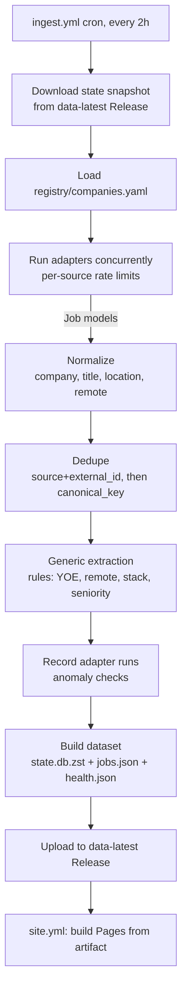
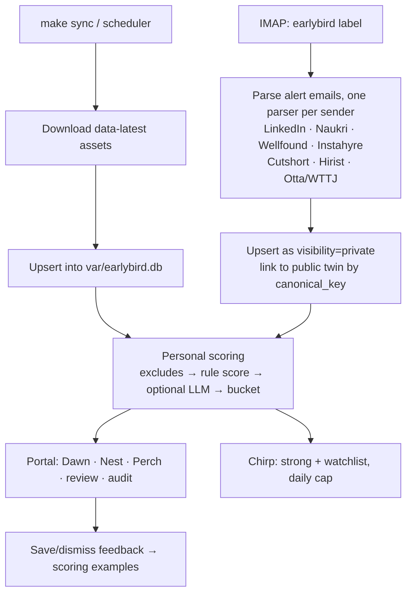

# Architecture

> Last updated: 2026-10-18 · Related: [data-model](data-model.md) · [matching](matching.md) · [operations](operations.md) · ADRs [0002](decisions/0002-two-planes.md), [0009](decisions/0009-public-state-in-release-assets.md), [0013](decisions/0013-privacy-boundary-import-linter.md)

## The two planes

Earlybird is split by **who may see the data**, not by technology.

| | Public plane | Private plane |
| --- | --- | --- |
| Runs on | GitHub Actions (cron) and GitHub Pages | Your laptop |
| Data | Public job postings only | Your profile, scores, tracker, email-derived jobs |
| Storage | Rolling `data-latest` Release assets | `var/earlybird.db` (SQLite) |
| Packages | `core`, `db`, `adapters`, `health`, `discovery`, `enrich`, `publish` | `private`, `notify`, `portal`, plus the public packages |
| Output | `jobs.json` + state snapshot + site | Dawn/Nest portal, Chirp alerts |

**The rule that makes this safe:** public-plane packages cannot import private-plane packages. CI enforces this with import-linter ([ADR 0013](decisions/0013-privacy-boundary-import-linter.md)). Also, the public workflow never has the secrets or files (profile, email credentials) that private code would need.

## Public plane: data flow

1. **Adapters** fetch one source each and yield `Job` models ([data-model](data-model.md#job)). They know nothing about storage.
2. **Normalize** cleans up names, splits locations, and maps remote wording to an enum.
3. **Dedupe** first matches `(source, external_id)` within a source. Across sources it matches a `canonical_key` (normalized company + title + location). A job keeps the list of every source it was seen on, and a `first_seen_at` timestamp.
4. **Generic extraction** derives facts that are true for everyone (YOE range, remote type, stack, seniority) using rules. An LLM may fill in unknowns when one is configured ([matching](matching.md)).
5. **Publish** writes a full state snapshot (for the next run and for `make sync`) and a slim `jobs.json` (for the board).

## Private plane: data flow

## Components

| Package | Responsibility |
| --- | --- |
| `core` | `Job` model, config (pydantic-settings), logging (structlog), shared HTTP client (UA, timeouts, retries, rate limits), normalize, dedupe |
| `db` | SQLAlchemy Core tables, Alembic migrations, repositories. Portable SQL only. |
| `adapters` | One module per source, all implementing the `Adapter` protocol. `contrib/` holds optional big tech adapters. |
| `health` | Adapter run records, anomaly rules, health report |
| `discovery` | Flock: finds candidate companies and their ATS slugs |
| `enrich` | Generic, public-safe extraction (rules, optional LLM) |
| `publish` | Builds the state snapshot, `jobs.json` and `health.json` |
| `private` | Sync, email ingestion, personal scoring, tracker, feedback |
| `notify` | Chirp (Telegram) |
| `portal` | FastAPI + HTMX local web app ([ADR 0010](decisions/0010-portal-fastapi-htmx.md)) |
| `cli.py` | One `earlybird` command, used by Make, the Procfile and Actions alike |

## Local processes (Phase 0b onwards)

`make up` starts a `honcho` process group in the background (pidfile in `var/run/`, logs in `var/logs/`) from the `Procfile`:

- `portal`: the web UI on `localhost:8765`
- `scheduler`: periodic `sync → ingest-email → score → chirp`, once an hour while the laptop is awake

`make down` stops the group. Data lives in `var/` and survives both commands.

## Portability

The private plane is configured only through environment variables (`EARLYBIRD_*`, with `.env` locally). Every scheduled task is a plain CLI command, and the DB is reached through `EARLYBIRD_DATABASE_URL`. Moving it to a server is therefore a deploy, not a rewrite ([ADR 0014](decisions/0014-portable-private-plane.md)).

## Failure modes

| Failure | Effect | Detection | Recovery |
| --- | --- | --- | --- |
| One adapter errors or changes its payload shape | That source's jobs are missing from this run; others are unaffected | `health`: error status, zero results 3 runs in a row, or a >70% drop vs the 7-day average | The fixture test fails once the payload is updated; fix the adapter |
| GitHub cron delayed or skipped | The dataset is late | `health.json` `generated_at` is older than 4h → stale banner in the portal | Usually self-heals; trigger manually with `gh workflow run ingest.yml` |
| Cron disabled after 60 days of repo inactivity | Ingestion silently stops | Stale-dataset banner; `keepalive.yml` prevents it | Re-enable the workflow |
| Release asset upload fails | The next run starts from older state; nothing lost except freshness | Workflow failure email | Re-run; uploads are idempotent |
| Corrupt state snapshot | Dedupe history lost | Checksum mismatch on download | The previous snapshot is kept as `state.prev.db.zst` |
| Email parsing breaks (template change) | Email-derived jobs stop | Parser health check: 0 jobs parsed from N new emails | Update the parser with a saved fixture email |
| LLM unavailable or over cap | Unknown facts stay unknown | Logged; counted in health | Fail open: jobs go to "maybe", never dropped |
| Laptop asleep | No Chirp alerts, stale local data | n/a | Catches up on the next `make up` or sync |
